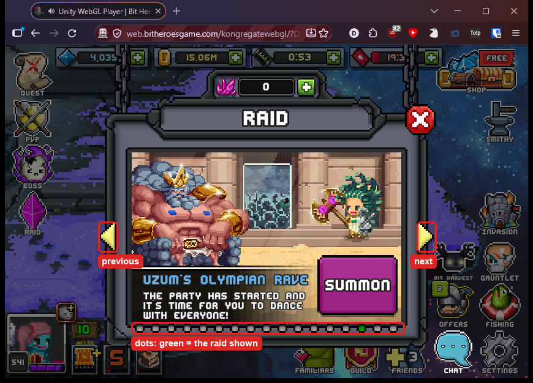
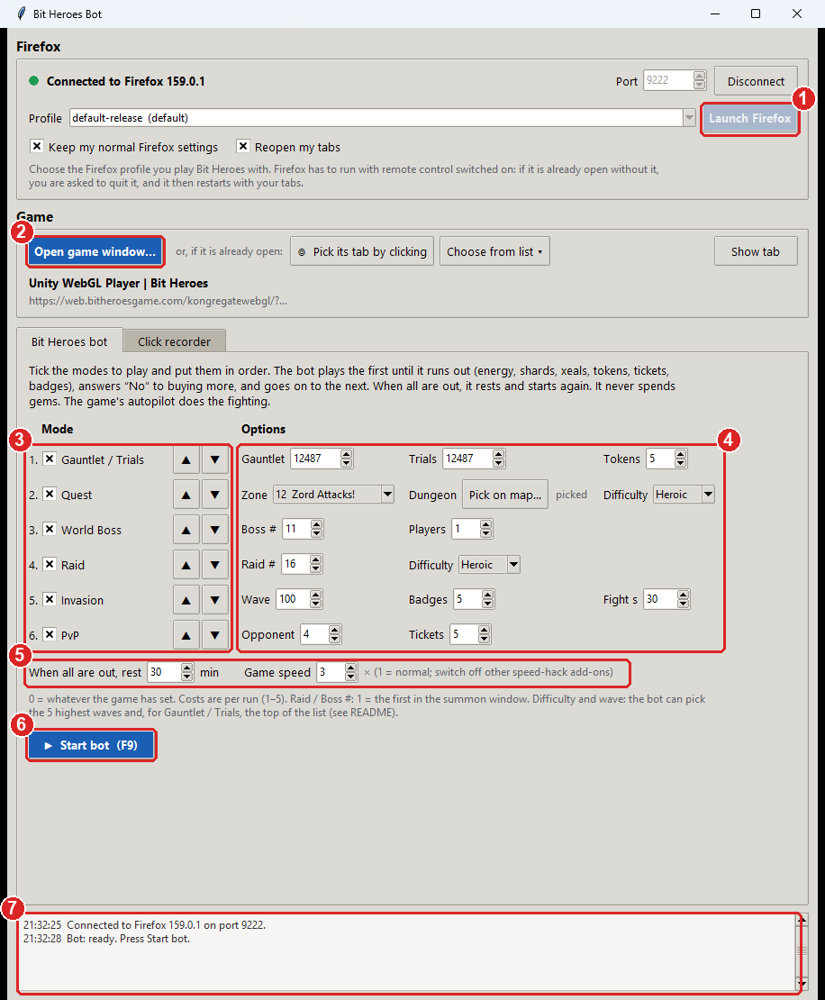
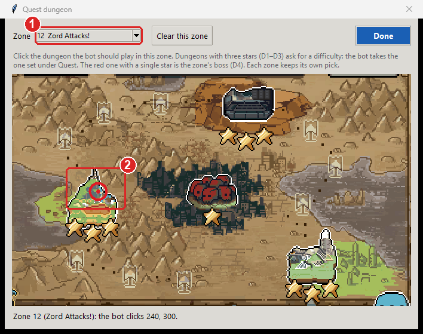
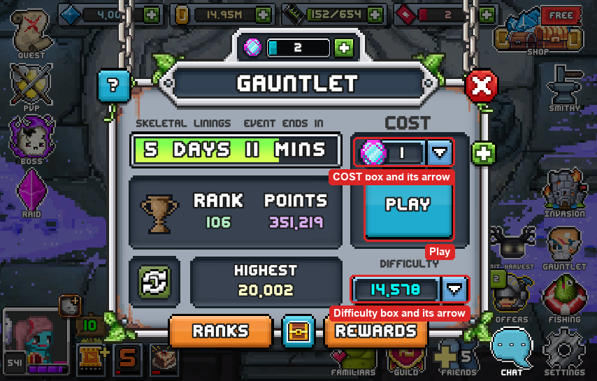

# Bit Heroes Auto Bot

A bot that plays **Bit Heroes** (the browser version, on Kongregate or
web.bitheroesgame.com) in Firefox **without moving your mouse**. It runs your
Raids, World Bosses, Invasion, Gauntlet / Trials, PvP and Quest dungeons one
after another, clicks through the menus between runs, and lets the game's own
autopilot do the fighting. While it plays, you can keep using your computer,
other windows and other Firefox tabs.

It is also a general **auto clicker for one Firefox tab**: record clicks once
and replay them, with image checks that wait for buttons to show up. See
[Recording your own clicks](#recording-your-own-clicks).

Runs on **Windows** and **Linux**.



## Install

You need Python 3.9 or newer (with Tk) and a recent Firefox.

### Windows

Tested on Windows 11 with Firefox 159 and Python 3.15.

1. Install Python from [python.org](https://www.python.org/downloads/). Tk is
   included. In the installer, tick **Add python.exe to PATH**.
2. Open PowerShell in the app's folder (in Explorer: Shift + right-click the
   folder → "Open PowerShell window here") and run:

   ```powershell
   pip install -r requirements.txt pillow numpy
   python .\autoclicker.py
   ```

   If `python` opens the Microsoft Store instead, Windows' Store shortcut is
   in the way: switch off "App execution aliases" for python in Settings →
   Apps → Advanced app settings, or run Python by its full path, for example
   `& "$env:LOCALAPPDATA\Programs\Python\Python315\python.exe" .\autoclicker.py`.
3. Set Windows display scaling to **100%** (Settings → System → Display →
   Scale). The bot compares the game with pictures taken at 100% and stops
   with a message otherwise. To keep your scaling instead, set
   `layout.css.devPixelsPerPx` to `1` in Firefox's `about:config` (Firefox
   then looks smaller).

### Linux

Tested with Firefox 156 (snap) and Python 3.10 on Ubuntu 22.04.

```bash
sudo apt install python3-tk                  # if Tk is missing
pip install -r requirements.txt pillow numpy
./autoclicker.py
```

Pillow and numpy are optional, but without them the bot reads the game's
screen much more slowly.

## Quick start



1. **Start Firefox with remote control.** Choose your Firefox profile (the
   one you play Bit Heroes with, so you are logged in) and press **Launch
   Firefox** ①. If Firefox is already open, the app asks you to quit it first
   (menu ☰ → Quit) and then restarts it with your tabs. While remote control
   is on, Firefox shows a striped address bar and a robot icon.
2. **Open the game in its own window.** Press **Open game window…** ② and
   keep the address it suggests (Bit Heroes on Kongregate), or paste another
   game link. Log in if the game asks, and wait for the town. Don't maximize
   or minimize this window; other windows may cover it. If the game is
   already open in a tab, press **Pick its tab by clicking** and click in the
   game instead.
3. **Choose what to play** on the **Bit Heroes bot** tab. Tick the modes ③
   and put them in order with ▲ ▼. The bot plays the first one until it runs
   out (energy, shards, tickets…), then the next, and so on. Each mode's
   options are on its row ④, the general ones below ⑤ (see
   [Bot settings](#bot-settings)). The defaults work.
4. **Press Start bot** ⑥ (or F9). The bot resizes the game window to the
   size it knows (854 × 545) and starts. The line next to the button shows
   what it is doing, each mode's row counts its runs, and the log ⑦ lists
   every step.

To stop, press **Stop bot**, F9 or Esc. The app remembers your choices, so
next time it's Launch Firefox, Open game window, Start bot.

The bot leaves your teams and the World Boss tier and difficulty to you: set
them once in the game, which remembers them.

## Bot settings

Each mode has its options on its own row. 0 means "whatever the game has
set".

| Mode | Option | What it does |
| --- | --- | --- |
| Gauntlet / Trials | Gauntlet, Trials | The number for the Difficulty box. Gauntlet and Trials alternate weekly and have a setting each. |
| | Tokens | Tokens per run (1–5), set in the COST box. Default 5. |
| Quest | Zone | Which zone, from 1 (Bit Valley) to 20 (Big Claw). |
| | Dungeon | **Pick on map…**: click the dungeon to play in that zone (see below). |
| | Difficulty | Normal, Hard or Heroic, for dungeons that ask (all but the zone's boss). |
| World Boss | Boss # | Which boss to summon (1 = the first). |
| | Players | Wait in the lobby until this many players have joined (1 = start alone). |
| Raid | Raid # | Which raid to summon (1 = the first). |
| | Difficulty | Normal, Hard or Heroic. |
| Invasion | Wave | The number for the Wave box. |
| | Badges | Badges per run (1–5). Default 5. |
| | Fight s | Seconds of fighting per run (enough for the loot); then the bot leaves the battle and collects. |
| PvP | Opponent | Which row of the opponent list to fight (1 = the top, usually the weakest). |
| | Tickets | Tickets per fight (1–5). Default 5. |
| All | When all are out, rest | Minutes to wait when every mode is out, before starting again. |
| | Game speed | Runs the whole game this many times faster (1 = normal). Switch off any other speed-hack add-on, or the speeds multiply. |

When one mode runs out, the bot answers **No** to the offer to buy more and
goes to the next. It never spends gems. A cost of 5 needs 5 tickets (or
tokens, badges) left: with fewer, the game says "not enough", and the bot
counts that mode as out until its rest is over.

**Raid and World Boss number:** these windows show one raid or boss at a
time (see the picture at the top). The bot presses the arrows until the
green dot under the picture is the one you chose.

**Quest zone and dungeon:** the bot recognises the zone by its title and
walks there with the arrows. Then it clicks the dungeon you picked for that
zone. Press **Pick on map…**, choose the zone ①, and click the dungeon ②.
Each zone keeps its own pick, and a zone you haven't picked in gets the
default spot (430, 300), the middle of the map.



Each zone has three dungeons with three stars (D1–D3), which ask for a
difficulty (the Quest **Difficulty** option), and a red one with a single
star, the zone's boss (D4).

**Gauntlet / Trials difficulty, Invasion wave and costs:** before pressing
Play, the bot reads the Difficulty (or Wave) box and the COST box. If one
isn't what you set, it opens that box's list and clicks yours. The game's
lists only take clicks reliably on the rows shown when they open, so the bot
only picks from those: costs 1–5, the five highest waves, and for
Gauntlet / Trials the five hardest ranges and the top 40 of each range. For
anything further down, the log says so; set it once in the game, which keeps
it.



## What the bot does by itself

- **Menus between runs:** Rerun (Quest, Raid); Play, Fight and Accept (PvP,
  Gauntlet / Trials, Invasion); a dungeon's difficulty; Summon, Start and
  Regroup (World Boss). The
  fighting is left to the game's autopilot, and the bot switches autopilot
  back on whenever it finds it off.
- **Invasion** goes on wave after wave, but the loot drops early. After the
  set fight time (game time: at 3× speed, 30 s take 10 s) the bot presses
  **Esc**, confirms "quit this battle" and collects the loot. If the game
  ignores Esc, it switches autopilot off, presses the battle's X and confirms.
- **Popups:** "Are you still there?", "Disconnected" (Reconnect), the daily
  reward, "Your team is not full" (Yes), and character dialogs (the text box
  with a yellow arrow, e.g. the first meeting with a boss, which a new
  browser shows again).
- **Missed clicks:** a click that changes nothing for 4 seconds is repeated,
  after resetting the input.
- **Frozen game:** battles and loading screens always move. If the picture
  stays still for 90 seconds, the game has hung, and the bot reloads it. A
  hung page often won't even reload; then the bot closes it and opens the
  game again in a new window of the right size.
- **Unknown screens** (battles, loading) are left alone. After 3 minutes on
  a screen it doesn't know, the bot saves a screenshot in the `bot-screens`
  folder next to the settings (see [Files](#files)); after 15 minutes it
  reloads the game.

## If something goes wrong

- **The bot stops at once:** the log says why. Usually the game window is
  maximized (so it can't be resized), or the zoom or display scaling isn't
  100% (press Ctrl+0 in Firefox).
- **The bot waits on a screen and does nothing:** it doesn't know that
  screen. Press Stop and look in the `bot-screens` folder; such a screenshot
  is what is needed to teach the bot that screen.
- **The game froze while its window was covered (Windows):** the app switches
  this off when it starts Firefox. If you started Firefox yourself, set
  `widget.windows.window_occlusion_tracking.enabled` to `false` in
  `about:config` once.
- **"Firefox is busy":** Firefox allows only one remote-control session. The
  app offers to restart Firefox; your tabs are reopened.
- **The game doesn't speed up:** reload it once (F5) while the bot runs.

Most online games, Kongregate's included, forbid bots, and a page can tell
that Firefox is remote-controlled. Use this at your own risk.

---

# Recording your own clicks

The rest of this page is about the general auto clicker: recording clicks in
any Firefox tab and replaying them, with image checks, presets and a flow
chart. It is on the app's **Click recorder** tab. The Bit Heroes bot above
doesn't need any of it.

It uses Firefox's built-in remote-control protocol (WebDriver BiDi). Clicks
are generated inside Firefox for that one tab, so the page receives real
("trusted") mouse events and the operating system's pointer never moves. On
Linux nothing depends on X11 tools, so it should also work on Wayland, but it
was only tested on X11.

## How to use

1. **Firefox**: choose a profile and press **Launch Firefox**. Firefox must
   run with remote control switched on. If it is already open without it, the
   app asks you to quit Firefox (menu ☰ → Quit, or Ctrl+Q). It then restarts
   Firefox with remote control and reopens your tabs. While remote control is
   on, Firefox shows a striped address bar and a robot icon.
2. **Target tab**: press **Pick its tab by clicking** (in the Game section),
   then click anywhere inside the page you want to automate. That click is
   swallowed, so it does not press anything. You can also use **Choose from
   list**. Then switch to the **Click recorder** tab.
3. **Clicks**: press **Record** (F8) and click in the target tab as usual.
   Left, middle and right clicks, double clicks and drags are recorded,
   including clicks inside iframes. Press **Stop recording** when done.
   Double-click a row to change its wait time. **Save…** and **Open…** store
   recordings as JSON.
   - **Inserting in the middle:** select a row before pressing Record and
     choose "Insert after #N". Or right-click a row and choose "Record clicks
     after this…" or "Add image check after this…". **＋ Image check…** also
     inserts after the selected row.
   - **Moving steps:** right-click → Move up / Move down, or press Alt+↑ /
     Alt+↓.
4. **Play** (F9): choose how often and how fast, then press Play. Esc stops
   everything.

**Page size:** click positions and image checks depend on the size of the
page.
- Press **Save this size** (under Target tab) to remember the current page
  size.
- **Resize to it** puts the window back to that size. With **before
  playing** ticked, playback does this on its own first.
- The size is kept per preset.

For a classic "click one spot every N ms" auto clicker, record a single click,
choose **Fixed interval**, and tick **Forever**.

### Presets

Keep one set of clicks for each game mode, for example "Dungeon", "PvP" and
"Raid".
- **Save a preset:** press **Save preset…** and give it a name. A preset stores
  the clicks, the image checks and all Play settings, including Game mode.
- **Switch presets:** choose one from the **Preset** dropdown.
- **Unsaved changes:** after you edit a preset, the app shows "unsaved changes".
  If you switch away, it asks first. To update the preset, save it again under
  the same name.

Presets are kept in `~/.config/tab-autoclicker/presets/` (on Windows
`C:\Users\<you>\.config\tab-autoclicker\presets\`), one JSON file each.
They use the same format as **Save…**/**Open…** files, so you can copy them to
another computer or share them.

**Chaining presets:** an image check can end the current preset and start
another one. Choose "click it, then go to preset" or "go to preset" in the
check's settings, and choose which preset comes next.
- Each preset then plays with its own Play settings.
- A chain can loop. For example, "Dungeon" ends with "Victory → click it, then
  go to preset Raid", and "Raid" ends with a check that goes back to "Dungeon".
- If you press Esc or Stop just as a preset ends, the switch is cancelled.
- Before playing, the app asks you to save unsaved changes, because switching
  presets replaces the steps on screen.

## Browser games

Games like Bit Heroes draw everything on one `<canvas>`, so the app cannot see
buttons as page elements. Instead it clicks positions and can look at the
screen with **image checks**.

1. Launch Firefox as above, then press **Open game window…**. The
   default address is the Bit Heroes page on Kongregate. A direct game link
   works too. The game gets a window of its own, and **Game mode** is switched
   on.
2. Keep that window open and don't minimize it. Other windows may cover it,
   and you can keep working elsewhere.
   - Games only run while their tab is visible. A background tab or a
     minimized window freezes them.
   - Game mode notices this and pauses playback until the tab is visible again.
3. Record your clicks. Where the game needs time, for example waiting for a
   fight to end, press **＋ Image check…**. You can do this during recording.
   Drag a box around something that shows the game is ready, such as the
   button you want to press next, and choose what happens:

| Setting | Meaning |
| --- | --- |
| Wait until it appears / disappears | What to wait for. |
| Wait at most N seconds | 0 checks once without waiting. |
| When found | Click it, then go on. Or: click it, then go to a step or a preset; go on; skip the next step; go to a step; start the next repeat; go to a preset; or stop playback. |
| If not found | Stop playback, go on, skip the next step, go to a step, start the next repeat, or go to a preset. |
| Go to step | For the "go to step" actions: the step to jump to. See [Jumping to steps](#jumping-to-steps). |
| Run this check only when another check jumps to it | Normal playback skips this check; it runs only as the target of a jump. |
| Click at | Where "click it" clicks: the middle of the image, or a point you choose by right-clicking the screenshot. The point can be outside the box, for example the "Continue" button under a "Victory" banner. If the image is found slightly moved, the point moves with it. |
| Go to preset | For the "go to preset" actions: a named preset, or the next preset in the list (after the last one it wraps to the first). |
| Click delay | For "click it": wait this many milliseconds after the image is found, then click. It helps with buttons that appear before the game accepts clicks on them. |
| Wait after | Wait this many milliseconds after a successful check (after its click) before going on. If the image isn't found, playback goes on at once. |
| Click again | If the image is still there this long after the click, the click probably didn't register (the game was busy, or thought it was in the background), so click it again, up to this many times. Before each extra click, the input is reset the way Stop and Play would: Firefox forgets its mouse state, and in Game mode the game briefly sees itself lose focus and get it back. 0 = off. Only use it for buttons that go away when clicked. |
| Match needed | Share of pixels that must match. The default is 80%. Lower it a little if the button glows or moves. |
| also when lighter or darker | Also match when the whole image got lighter or darker, like a hovered button or one that is fading in. Colours still count, so a red or grey button won't match a green one. Leave it off for checks that must tell a dimmed (disabled) button from the normal one. |

**Test now** shows how well the box matches the game at this moment. It
doesn't click.

**Test and click** does the same check. If the image is found and "When found"
clicks, it waits the click delay and clicks, as playback would. It doesn't
follow "go to step" or "go to preset". It uses Game mode if Game mode is on,
and it doesn't work during recording or playback.

A new check starts with the settings of the last one you added. The first time,
that is: look once, click it if found, otherwise go on.

### Jumping to steps

A check can jump to another step, for example to handle a popup that only
shows up sometimes:

1. Put the step that handles it at the end, for example a click on
   "Reconnect".
2. Mark the "Reconnect" step itself as "only when jumped to". For a check,
   tick **Run this check only when another check jumps to it** in its own
   dialog. For a click, right-click it and choose **Run only when a check
   jumps here**.
3. Add a check for the popup, for example "Disconnected". Set **When found**
   to "click it, then go to step" (or "go to step") and choose the
   "Reconnect" step.

What happens:
- Normal playback skips steps marked this way. They show a ↪ and a purple
  tint.
- When a check jumps to a marked step, that step runs, together with any
  marked steps directly after it. Playback then comes back to the step after
  the check.
- Jumps from one marked step to another stay in the same side branch. Playback
  comes back once, to where the branch was entered.
- Jumping to a step that isn't marked is a plain "go to", and playback
  continues from there. Use it for loops.
- To mark or unmark any step, right-click it in the list and choose "Run only
  when a check jumps here".

### Flow chart

Press **Flow chart…** (next to the presets) to see the steps as a diagram.
It stays in sync with the list, and playback highlights the running step in
yellow.

**What the chart shows:**
- Boxes are steps. Image checks are blue and show a thumbnail of their image.
  "Only when jumped to" steps sit in a purple column on the right.
- Arrows show where playback goes next:
  - green for "found", orange for "not found";
  - dashed purple for "back after the jump";
  - the arrow on the left is the repeat.
- Arrows can also end at **Stop playback**, **End of round**, or a preset
  (green, top right).

**Using it:**
- Click a box to select its row in the list. Double-click it to edit.
  Right-click it for the same menu as in the list.
- To change where a check goes, drag its green ● (found) or orange ●
  (not found) handle onto another box: a step, End of round (start the next
  repeat), Stop, or a preset.
- Dropping onto a step points the jump there. Clicking is kept: "click it"
  becomes "click it, then go to…". Whether that step runs only when jumped
  to is its own setting.
- Double-click a preset box to load that preset.

Examples:
- **Wait for a button:** wait up to 60 s for the "Fight" button, click it when
  it appears, and stop if it never does.
- **Stop when out of energy:** check once for the "not enough energy" popup.
  When found, stop playback. If not found, go on.

**What Game mode does**
- **Keeps the game focused:** Unity WebGL games stop reacting to the mouse when
  their window loses focus. Game mode hides that "window lost focus" event from
  the game while playback runs, so it keeps taking clicks while you work in
  other windows.
- **Pauses while hidden:** playback waits while the game tab is hidden.
- **Longer presses:** every press lasts at least 50 ms, because games read the
  mouse only once per frame.

**Tips**
- Keep the game window the same size, and keep the zoom level unchanged
  (Ctrl+0 resets it). Both click positions and image checks depend on it.
- Pick image-check regions without numbers, timers or animations.
- On a Linux desktop without a compositor, a completely covered window counts
  as hidden, and the game freezes. This doesn't happen on normal Ubuntu GNOME.
  On Windows, the same happens unless window occlusion tracking is off (see
  [On Windows](#on-windows)).
- Game rules: most online games, including Kongregate games, forbid bots and
  auto clickers, and a page can tell that Firefox is remote-controlled.
  Use this at your own risk.
- A direct game link (`web.bitheroesgame.com/...?kongregate_game_auth_token=...`)
  contains your login token. Don't share it. The app leaves such tokens out of
  its settings file, saved recordings and log.

### Playback options

| Option | Meaning |
| --- | --- |
| Recorded timing, speed × | Replays the recorded gaps between presses, divided by the speed. |
| Sleep between rounds | Wait this many seconds after a round before starting the next one. It works with both timings, and while it waits, the progress line shows when the next round starts. |
| Fixed interval | Every click, including across repeats, is exactly this far apart. |
| Random extra wait | Adds 0–N ms before each click. |
| Aim at recorded position | Clicks the same spot on the page. |
| Aim at recorded element | Finds the clicked element again and clicks it even if it moved. It falls back to the position if the element is gone. |
| Restore page scroll position | Scrolls the page back to where it was when that click was recorded. |
| Show click markers | Draws a short ring where each replayed click lands. |
| Game mode | For browser games. See [Browser games](#browser-games). |

## On Windows

- **Launch Firefox** finds Firefox in the registry or `Program Files`, and
  your profiles in `%APPDATA%\Mozilla\Firefox`. The separate Auto Clicker
  profile is kept in `%LOCALAPPDATA%\tab-autoclicker\firefox-profile`.
- When the app starts Firefox, it also switches off
  `widget.windows.window_occlusion_tracking.enabled` in that profile's
  `user.js`. Otherwise Windows Firefox pauses a game whose window is covered
  by other windows. If you start Firefox yourself
  (`"C:\Program Files\Mozilla Firefox\firefox.exe" --remote-debugging-port 9222`),
  set it to `false` in `about:config` once.
- **Show tab** may not bring the tab to the front: Firefox waits for its
  window to get the keyboard focus, which Windows does not give to it while
  another program is in front. It gives up after 30 seconds.
- Settings and presets are in `C:\Users\<you>\.config\tab-autoclicker\`.

## What the app changes in Firefox

- **Keep my normal Firefox settings** adds one line to the chosen profile's
  `user.js`: `remote.prefs.recommended = false`. Without it, Firefox's remote
  control mode would switch off Safe Browsing, tracking protection, password
  saving, the popup blocker and extension updates for as long as it runs.
- **Reopen my tabs** asks Firefox, once, to restore the previous session on
  the next start. This is the same one-time setting Firefox uses for its own
  restarts.
- On Windows, starting Firefox also adds
  `widget.windows.window_occlusion_tracking.enabled = false` to `user.js`
  (see [On Windows](#on-windows)).
- While connected, the app asks Firefox to leave page dialogs such as
  `alert()` and "Leave page?" for you to answer. By default, remote control
  would dismiss them automatically.

## Good to know

- **Security:** while Firefox runs with remote control, any program on this
  computer can control it through `127.0.0.1:<port>`. To switch it off, quit
  Firefox and start it normally.
- **Bot detection:** pages can see `navigator.webdriver = true` while remote
  control is on. Some sites treat this as automation.
- **One session at a time:** Firefox allows only one remote-control session.
  The app ends its session on exit. If it ever crashes, Firefox stays "busy"
  until it restarts, and the app offers to restart it for you.
- Positions are page coordinates in CSS pixels. If you resize the window or
  zoom, use **Aim at recorded element**.
- Firefox's own pages, such as New Tab and Settings, cannot be picked or
  recorded. Tabs restored after a restart only load once you view them.
- Only mouse clicks and drags are recorded. Keyboard input and mouse-wheel
  scrolling are not.

## Files

- `autoclicker.py` starts the app.
- `tab_autoclicker/gui.py` is the main window: Firefox, the game, and the
  Bit Heroes bot and Click recorder tabs.
- `tab_autoclicker/gui_check.py` is the image-check dialog.
- `tab_autoclicker/gui_flow.py` is the flow chart window.
- `tab_autoclicker/gui_bot.py` is the Bit Heroes bot tab and the dungeon
  picker, and `tab_autoclicker/bitheroes.py` the bot's screens and decisions,
  with the reference images in `tab_autoclicker/bitheroes/` and the zone maps
  for the picker in `tab_autoclicker/bitheroes/maps/`.
- `tab_autoclicker/engine.py` handles picking, recording, playback and image
  checks.
- `tab_autoclicker/imaging.py` decodes PNG screenshots and finds images in them.
  It needs only the standard library, and uses numpy if installed.
- `tab_autoclicker/bidi.py` is a small WebDriver BiDi client.
- `tab_autoclicker/firefox.py` finds profiles and launches Firefox, on Linux
  and Windows.
- `tab_autoclicker/agent_js.py` holds the scripts injected into the page, in an
  isolated sandbox the page cannot see. The exception is the bot's game
  speed (`SPEED`), which must run in the page's own realm to change its clocks.
- `tests/test_bitheroes.py` checks the bot's screen recognition and decisions,
  and `tests/test_imaging.py` the image matching. Neither needs a browser.
- `tests/e2e_headless.py` is a self-test. It starts its own hidden Firefox
  with a temporary profile. It checks picking, recording and background replay.
  It also checks image checks and game mode on a small canvas game. It needs
  tab switching, which hangs in Firefox on Windows, so run it on Linux.
- `tests/e2e_speed.py` checks the bot's game speed and Esc key in a hidden
  Firefox, and `tests/e2e_bot_freeze.py` its recovery from a frozen game.
  Both run on Linux and Windows.
- `tests/make_glyphs.py` rebuilds the templates the bot reads the game's
  numbers with (`tab_autoclicker/bitheroes/glyphs.json`) from the screenshots
  in `tests/data/`.
- `docs/images/` holds the pictures in this README.

Run a test with `python3 tests/<name>.py` on Linux, or
`python .\tests\<name>.py` on Windows.

Settings (including the bot's) and the last recording are saved in
`~/.config/tab-autoclicker/settings.json`, presets in
`~/.config/tab-autoclicker/presets/`, and the bot's screenshots of screens it
doesn't know in `~/.config/tab-autoclicker/bot-screens/`. On Windows that
folder is `C:\Users\<you>\.config\tab-autoclicker\`.
